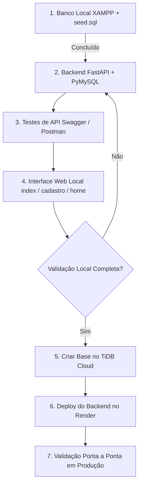

# Guia de Configuração de Ambiente e Execução — Ello Mineiro MVP

> Este documento registra o processo de configuração do ambiente local, a integração com o banco de dados e o roteiro detalhado de execução antes do início da codificação do backend FastAPI.

---

## 1. Etapa 1 Concluída: Banco de Dados Local e Ferramentas

O ambiente de banco de dados para desenvolvimento local foi estruturado com sucesso utilizando as seguintes ferramentas:

### 1.1. Pilha Local Utilizada
* **SGBD Local:** **MySQL Server** (executado via **XAMPP**).
* **Interface Visual (GUI):** **DBeaver Community** conectado ao servidor local:
  * **Host:** `localhost` (ou `127.0.0.1` — endereço local interno)
  * **Porta:** `3306` (porta padrão do MySQL)
  * **Usuário:** `root` (padrão de desenvolvimento local do XAMPP)
  * **Senha:** *(vazia por padrão em ambientes de estudo locais)*
* **Banco Criado:** `ello_mineiro` (charset `utf8mb4`, collate `utf8mb4_unicode_ci`).
* **Carga Inicial:** Script [database/seed.sql](file:///c:/Users/israe/Documents/ESTUDOS%20PROGRAMA%C3%87%C3%83O%20WEB/projeto-grau-tec/ello-mineiro-mvp/database/seed.sql) executado com sucesso, criando:
  1. `Permissoes` (com carga inicial dos 5 perfis fixos: `Usuario`, `Aluno`, `Professor`, `Suporte`, `Administrativo`).
  2. `Usuarios` (com credenciais, dados pessoais e telefone padronizado em 11 dígitos).
  3. `Endereco` (relacionamento 1:N com validação `CHECK` em `situacao`).

> **Nota de Segurança:** Em ambientes de produção reais, nunca utilize o usuário `root` nem deixe o banco sem senha forte. Para o ambiente de estudo local isolado na sua máquina (sem exposição externa na rede), o padrão do XAMPP é suficiente.

### 1.2. Preparação para Produção (Nuvem)
* Conta criada na plataforma **TiDB Cloud Serverless** (compatível com MySQL).
* O mesmo arquivo [database/seed.sql](file:///c:/Users/israe/Documents/ESTUDOS%20PROGRAMA%C3%87%C3%83O%20WEB/projeto-grau-tec/ello-mineiro-mvp/database/seed.sql) será executado no cluster do TiDB quando o projeto for para a fase de deploy em produção.

---

## 2. Configuração de Variáveis de Ambiente (`.env`)

Para desacoplar as configurações sensíveis do código-fonte (em conformidade com o **RNF06**), foi criado o arquivo `.env` na raiz do projeto (bloqueado no `.gitignore`).

### 2.1. Estrutura das Variáveis
```env
# Banco de Dados (Configuração do XAMPP local)
DB_HOST=127.0.0.1
DB_PORT=3306
DB_USER=root
DB_PASSWORD=
DB_NAME=db_ellomineiro

# Parâmetro de SSL (Local = false / TiDB Cloud = true)
DB_SSL=false

# Autenticação e Segurança (JWT)
JWT_SECRET=coloque_uma_chave_secreta_forte_e_aleatoria_aqui
JWT_ALGORITHM=HS256
JWT_EXPIRES_MINUTES=60

# Chave Privada da Aplicação (Proteção de Mutabilidade via X-API-Key)
API_KEY=sua_chave_privada_da_aplicacao_aqui
```

### 2.2. Como o Backend Consumirá Essas Informações
* O arquivo `app/db.py` lerá essas variáveis usando a biblioteca `python-dotenv`.
* A conexão será criada via **PyMySQL** utilizando conexões dedicadas parametrizadas.
* A flag `DB_SSL`:
  * Quando `false` (ambiente local): conecta direto sem exigir certificados TLS.
  * Quando `true` (ambiente de produção no TiDB): ativa a criptografia TLS obrigatória exigida por bancos de dados em nuvem.
* A variável `API_KEY` é consumida pelo módulo `app/security_guards.py` para validar o cabeçalho `X-API-Key` em chamadas externas às rotas de mutabilidade (`/api/auth/register`, `/api/auth/login`, `/api/auth/logout`).

### 2.3. Padrão Seguro da Indústria para Geração de Chaves de API (`API_KEY`) e Segredos (`JWT_SECRET`)

> [!CAUTION]
> **Nunca utilize geradores de senha online ou sites da web** para criar chaves de API (`API_KEY`) ou segredos criptográficos (`JWT_SECRET`). Sites de terceiros podem registrar logs das chaves geradas, sofrer interceptação ou utilizar algoritmos de baixa entropia no navegador (como `Math.random()`), comprometendo toda a segurança do sistema.

O padrão seguro da indústria para geração de chaves criptográficas utiliza geradores de números pseudo-aleatórios criptograficamente seguros (**CSPRNG**) executados **localmente na sua própria máquina**:

1. **Entropia Mínima de 256 bits (32 bytes):**
   * Torna computacionalmente impossível adivinhar a chave via força bruta ($2^{256}$ combinações possíveis).
2. **Prefixo Identificador Institucional (Boas Práticas de Mercado):**
   * Semelhante ao padrão de APIs líderes (ex: Stripe `sk_live_...`, GitHub `ghp_...`), adota-se o prefixo `ello_live_` ou `ello_priv_`.
   * Facilita a auditoria de código e ativa detecção preventiva por ferramentas de *Secret Scanning* (como GitGuardian e GitHub Secret Scanning).
3. **Comandos Recomendados para Geração Local no Terminal:**
   * **Via Python (CSPRNG Nativo — Módulo `secrets`):**
     ```bash
     python -c "import secrets; print('ello_live_' + secrets.token_urlsafe(32))"
     ```
     *Exemplo de saída:* `ello_live_mQ7kL9_zT1pXy8W4rE3vA6bC5dF8gH2jK1nO0sP9uI4`
   * **Via Python em Hexadecimal:**
     ```bash
     python -c "import secrets; print('ello_live_' + secrets.token_hex(32))"
     ```
   * **Via OpenSSL (Linux / Mac / Git Bash no Windows):**
     ```bash
     openssl rand -hex 32
     ```
   * **Via PowerShell Nativo no Windows:**
     ```powershell
     powershell -Command "[Convert]::ToBase64String((1..32 | ForEach-Object { Get-Random -Minimum 0 -Maximum 256 }))"
     ```

---

## 3. Roteiro Passo a Passo de Execução (Pipeline Completo)

A implementação segue um fluxo estritamente incremental, garantindo que cada camada seja testada e validada antes de avançar para a próxima.



### Passo 1: Infraestrutura de Dados Local *(Concluído)*
- [x] XAMPP em execução (MySQL ativo).
- [x] Conexão no DBeaver configurada.
- [x] Base criada e `seed.sql` executado.
- [x] Arquivo `.env` configurado localmente.
- [x] Conta criada no TiDB Cloud.

---

### Passo 2: Construção do Backend FastAPI & Repositórios SQL *(Próxima Etapa)*
1. **Definir `requirements.txt`:**
   * `fastapi` e `uvicorn` (servidor web assíncrono).
   * `pymysql` e `cryptography` (driver de conexão com o MySQL).
   * `argon2-cffi` ou `passlib[bcrypt]` (hashing seguro de senhas).
   * `pyjwt` (geração e verificação do token JWT).
   * `pydantic` (validação dos contratos de dados recebidos no corpo das requisições).
   * `python-dotenv` (carregamento automático do `.env`).
2. **Gerenciador de Conexão (`app/db.py`):**
   * Função geradora de conexão (`get_connection()`) lendo as variáveis do `.env`.
   * Suporte a transação (`commit` / `rollback`).
3. **Camada de Repositórios (`app/repositories/`):**
   * **`usuarios.py`:**
     * `buscar_por_identificador(conn, identificador)`: busca por `user_login` ou `email` para o login.
     * `verificar_duplicidade(conn, user_login, email, cpf, rg)`: garante unicidade antes do insert.
     * `criar_usuario(conn, dados, senha_hash)`: insere usuário com perfil padrão `Usuario` (`RN05`).
   * **`enderecos.py`:**
     * `criar_endereco(conn, usuario_id, dados)`: insere endereço vinculado ao usuário dentro da mesma transação.
4. **Camada de Autenticação e Segurança (`app/security.py`):**
   * Funções `gerar_hash_senha(senha)` e `verificar_senha(senha, hash)`.
   * Funções de criação e decodificação do token JWT.
5. **Roteadores HTTP (`app/routers/`):**
   * `GET /health`: endpoint simples de verificação do status da API e teste de ping no banco.
   * `POST /api/auth/register`: recebe dados, valida tipos/formatos, cria usuário e endereço na mesma transação.
   * `POST /api/auth/login`: valida credenciais, gera JWT e retorna cookie `Set-Cookie` (`HttpOnly; Secure; SameSite=Lax`).
   * `POST /api/auth/logout`: limpa o cookie `access_token`.
   * `GET /api/me`: dependência que lê o cookie da requisição, valida o JWT e retorna os dados do usuário autenticado (sem a senha).
6. **Aplicação Principal (`app/main.py`):**
   * Inicialização do FastAPI.
   * Registro dos roteadores sob `/api`.
   * Montagem de arquivos estáticos (`StaticFiles`) servindo a pasta `frontend/static`.
   * Rota raiz `GET /` retornando `frontend/index.html`.
   * Rotas `GET /cadastro` e `GET /home` retornando as respectivas páginas HTML.

---

### Passo 3: Testes de API Isolados (Swagger / Postman)
Antes de ligar o front-end, a API será validada de forma independente:
1. Iniciar o servidor local:
   ```bash
   uvicorn app.main:app --reload
   ```
2. Acessar a documentação Swagger em `http://localhost:8000/docs`.
3. Executar cenários de teste:
   * **Cenário A:** Cadastro de usuário com dados válidos ➔ Esperado `201 Created`.
   * **Cenário B:** Tentativa de cadastro duplicado (mesmo `user_login` ou `email`) ➔ Esperado `409 Conflict`.
   * **Cenário C:** Login com credenciais corretas ➔ Esperado `200 OK` com cabeçalho `Set-Cookie`.
   * **Cenário D:** Consulta a `GET /api/me` após login ➔ Esperado `200 OK` com perfil `Usuario`.
   * **Cenário E:** Consulta a `GET /api/me` sem cookie ou com token inválido ➔ Esperado `401 Unauthorized`.
   * **Cenário F:** Logout ➔ Esperado cookie zerado/expirado.

---

### Passo 4: Integração com a Interface Web (Front-end Estático)
1. **Página de Login (`frontend/index.html`):**
   * Formulário com campos de identificador (`user_login` ou e-mail) e senha.
   * Chamada `fetch('/api/auth/login', { method: 'POST', ... })`.
   * Em caso de sucesso, redirecionamento via JavaScript para `/home`.
2. **Página de Cadastro (`frontend/cadastro.html`):**
   * Formulário com dados pessoais, endereço e credenciais (sem campo de perfil).
   * Chamada `fetch('/api/auth/register', { method: 'POST', ... })`.
   * Redirecionamento para a tela de login após cadastro.
3. **Página Inicial / Dashboard (`frontend/home.html`):**
   * Ao carregar, executa `fetch('/api/me')`.
   * Se retornar `401`, redireciona imediatamente para `/` (login).
   * Se autenticado, exibe mensagem de boas-vindas com o nome e perfil do usuário logado.
   * Botão de Logout chamando `POST /api/auth/logout`.

---

### Passo 5: Transição para Produção (Nuvem)
1. **Banco de Dados no TiDB Cloud:**
   * Acessar o console do TiDB Cloud.
   * Executar o script `database/seed.sql` no console SQL do TiDB.
   * Obter a string de conexão (host, porta 4000, usuário, senha, certificado TLS).
2. **Hospedagem da Aplicação no Render:**
   * Criar um novo **Web Service** no Render apontando para o repositório do GitHub.
   * Definir o comando de inicialização: `uvicorn app.main:app --host 0.0.0.0 --port $PORT`.
   * Configurar as Variáveis de Ambiente no painel do Render (`DB_HOST`, `DB_PORT`, `DB_USER`, `DB_PASSWORD`, `DB_NAME`, `DB_SSL=true`, `JWT_SECRET`).
3. **Validação Final em Produção:**
   * Acessar a URL pública gerada pelo Render (`https://seu-app.onrender.com`).
   * Executar o fluxo completo de cadastro, login e consulta.
